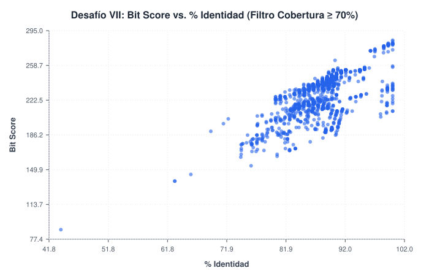
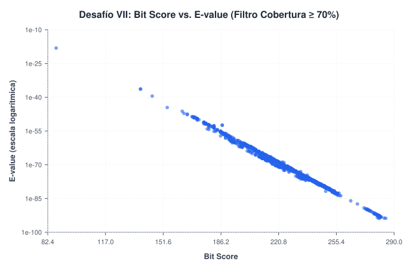
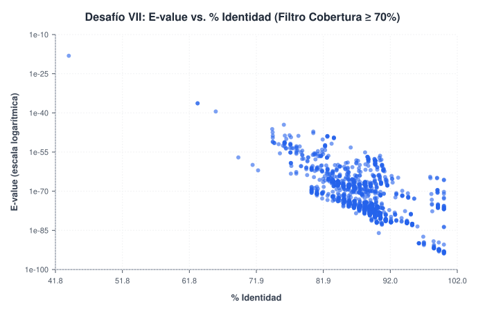
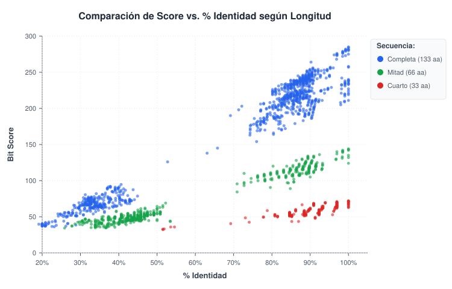

# Alineamientos y Búsqueda de Similitud Secuencial (BLAST)

Este trabajo práctico forma parte de la clase práctica de [Alineamientos y Búsqueda de similitud secuencial](../../Introduccion_a_la_Bioinformatica/Teorico_Practicos/Bioinform%C3%A1tica_Primeros_pasos/Alineamientos_secuenciales.md) (*Bioinformática: Primeros pasos*).

---

## 📋 Desafío VII: Análisis de Comportamiento de Métricas en BLASTp

> **Consigna:**
> Calculá el E-value y % identidad utilizando el programa Blast de la siguiente secuencia input usando 20000 hits, un e-value de 100 y tomando aquellos hits con un mínimo de 70% cobertura. Observe y discuta el comportamiento de:
> - **E-value vs. % id**
> - **Score vs. % id**
> - **Score vs. E-value**
>
> **Secuencia problema:**
> ```text
> VVGGLGGYMLGSAMSRPIIHFGSDYEDRYYRENMHRYPNQVYYRPMDEYSNQNNFVHDCVNITIKQHTVTTTTKGENFTETDVKMMERVVEQMCITQYERESQAYYQRGSSMVLFSSPPVILLISFLIFLIVG
> ```

---

### ⚙️ Metodología y Parámetros en NCBI BLAST

Para resolver el desafío se utilizó la herramienta web oficial **NCBI BLASTp** (*Protein BLAST*), ingresando la secuencia de 133 aminoácidos contra la base de datos de proteínas estándar (`nr`).

#### Aclaración sobre el número de hits:
La consigna propone buscar hasta `20000` hits. Sin embargo, en la interfaz web pública del NCBI, la opción máxima disponible en el menú desplegable de *Max target sequences* es de **5.000 hits** (`5000`) para no sobrecargar los servidores públicos. Se seleccionó dicho valor máximo, obteniéndose un total de **1.964 hits** que cumplieron con el umbral de significancia solicitado (E-value menor o igual a 100).

#### Parámetros configurados:
- **Base de datos:** `nr` (*Non-redundant protein sequences*).
- **Expect threshold (E-value):** `100` (permite incluir alineamientos con menor grado de conservación).
- **Max target sequences:** `5000` (límite técnico de la plataforma).
- **Filtro de Cobertura (Query Cover):** 70% o superior (aplicado sobre la tabla de resultados para analizar aquellos alineamientos que cubren la mayor parte de la secuencia problema).

Los resultados completos descargados de la plataforma se encuentran en [`CXGJKUJN014-Alignment-HitTable.csv`](data/CXGJKUJN014-Alignment-HitTable.csv). Al aplicar el filtro de cobertura mínima del 70%, se obtuvieron **1.597 hits**.

---

### 💡 Conceptos Clave de las Métricas

- **Score (Bit Score):** Es el puntaje asignado al alineamiento. Cuanto más se parecen las secuencias y mejor es la coincidencia entre sus aminoácidos, más alto es el score.
- **% Identidad:** Porcentaje de aminoácidos exactamente iguales en las posiciones que se alinearon.
- **E-value (Expect value):** Número de alineamientos con ese puntaje que se esperaría encontrar por pura casualidad en la base de datos. Cuanto más cercano a cero sea, más confiable es el alineamiento y menor es la probabilidad de que sea fruto del azar.
- **Query Cover (Cobertura):** Qué porcentaje de nuestra secuencia original está participando en el alineamiento. Al exigir un mínimo de 70%, nos aseguramos de comparar secuencias completas o dominios enteros y no coincidencias casuales muy cortas.

---

### 📊 Gráficos y Discusión de Comportamientos

#### 1. Score vs. % Identidad


- **¿Qué observamos?**
  Al aumentar el porcentaje de identidad, el score del alineamiento tiende a incrementarse. Las secuencias con 100% de identidad alcanzan los puntajes más altos (alrededor de 280).
- **Explicación:**
  Esto ocurre porque al haber una mayor cantidad de aminoácidos coincidentes entre las secuencias, la matriz de puntuación suma más valores positivos, elevando el score total.

---

#### 2. Score vs. E-value


- **¿Qué observamos?**
  A medida que el score del alineamiento aumenta, el E-value adopta valores sumamente bajos, cercanos a cero.
- **Explicación:**
  El score mide la calidad del alineamiento, mientras que el E-value estima cuántas secuencias con ese puntaje se esperarían encontrar por simple azar en la base de datos. Por ende, un score alto indica que es muy poco probable que la coincidencia sea casual, resultando en un E-value próximo a cero.

---

#### 3. E-value vs. % Identidad


- **¿Qué observamos?**
  Para porcentajes de identidad moderados y altos (por ejemplo, superiores al 50%), el E-value se mantiene en valores prácticamente nulos.
- **Explicación:**
  Cuando dos secuencias comparten muchos aminoácidos idénticos (alta identidad), el alineamiento obtiene un score elevado, lo que reduce la probabilidad de que la coincidencia ocurra por azar y se traduce en un E-value cercano a cero.

---

## 📋 Desafío VIII: Búsquedas con Fragmentos de la Secuencia (Mitad y Cuarto)

> **Consigna:**
> Realizá nuevas búsquedas usando la mitad de la secuencia problema y para un cuarto de la secuencia original. Compará los gráficos obtenidos. ¿Qué conclusiones podés sacar?

### ⚙️ Secuencias y Fragmentos Evaluados

A partir de la secuencia original de 133 aminoácidos, se definieron dos fragmentos:
* **Secuencia completa (133 aa):**
  `VVGGLGGYMLGSAMSRPIIHFGSDYEDRYYRENMHRYPNQVYYRPMDEYSNQNNFVHDCVNITIKQHTVTTTTKGENFTETDVKMMERVVEQMCITQYERESQAYYQRGSSMVLFSSPPVILLISFLIFLIVG`
* **Mitad de la secuencia (66 aa):**
  `VVGGLGGYMLGSAMSRPIIHFGSDYEDRYYRENMHRYPNQVYYRPMDEYSNQNNFVHDCVNITIKQ`
* **Un cuarto de la secuencia (33 aa):**
  `VVGGLGGYMLGSAMSRPIIHFGSDYEDRYYREN`

---

### 📊 Comparación de Resultados



| Muestra evaluada | N° de Hits | Score Máximo | E-value Mínimo | Archivo de resultados |
| :--- | :---: | :---: | :---: | :--- |
| **Completa (133 aa)** | 1.964 | 285.0 | 1.41e-94 | [`CXGJKUJN014-Alignment-HitTable.csv`](data/CXGJKUJN014-Alignment-HitTable.csv) |
| **Mitad (66 aa)** | 2.524 | 144.0 | 5.81e-42 | [`CXKA9G59014-Alignment-HitTable.csv`](data/CXKA9G59014-Alignment-HitTable.csv) |
| **Cuarto (33 aa)** | 1.691 | 72.0 | 2.19e-14 | [`CXKFNUSB016-Alignment-HitTable.csv`](data/CXKFNUSB016-Alignment-HitTable.csv) |

---

### 🧠 Conclusiones del Desafío VIII

Al comparar las búsquedas con secuencias de distinta longitud, se destacan dos observaciones principales:

1. **Reducción proporcional del Score máximo:**
   El puntaje máximo que puede alcanzar un alineamiento disminuye en proporción a la longitud de la secuencia de entrada. Esto ocurre porque el score se acumula residuo a residuo; al reducir la cantidad de posiciones disponibles para alinear, el puntaje total acumulable resulta menor.

2. **Aumento del E-value:**
   Aun considerando alineamientos con 100% de identidad, el E-value adopta valores mayores a medida que la secuencia se acorta. Esto se debe a que una coincidencia exacta de una secuencia larga es sumamente improbable que ocurra por azar en una base de datos grande. Una coincidencia de una secuencia corta tiene mayores probabilidades de aparecer de manera casual, por lo que el algoritmo le asigna un E-value más elevado.

---

## 📋 Desafío IX: Identificación de una Proteína Incógnita

> **Consigna:**
> Utilizando BLAST utilice búsquedas de similitud secuencial para identificar a la siguiente proteína:
> ```text
> MIDKSAFVHPTAIVEEGASIGANAHIGPFCIVGPHVEIGEGTVLKSHVVVNGHTKIGRDNEIYQFASIGEVNQDLKYAGEPTRVEIGDRNRIRESVTIHRGTVQGGGLTKVGSDNLLMINAHIAHDCTVGNRCILANNATLAGHVSVDDFAIIGGMTAVHQFCIIGAHVMVGGCSGVAQDVPPYVIAQGNHATPFGVNIEGLKRRGFSREAITAIRNAYKLIYRSGKTLDEVKPEIAELAETYPEVKAFTDFFARSTRGLIR
> ```
>
> **Preguntas disparadoras:**
> - ¿Cuál es la función de la proteína?
> - ¿A qué grupo taxonómico pertenece?
> - A un nivel de significancia estadística adecuado, ¿cuántas secuencias similares se encuentran?

### ⚙️ Metodología

La secuencia de 262 aminoácidos se ingresó en **NCBI BLASTp** contra la base de datos de proteínas no redundantes (`nr`). Los resultados obtenidos se registraron en [`CXMMCY4N014-Alignment-HitTable.csv`](data/CXMMCY4N014-Alignment-HitTable.csv).

El primer resultado de la tabla presentó una coincidencia del **100% de identidad** a lo largo de toda la secuencia (262/262 aminoácidos), con un E-value de `0.0`.

---

### 🧠 Respuestas a las Preguntas Disparadoras

1. **¿Cuál es la función de la proteína?**
   Corresponde a la enzima **UDP-N-acetilglucosamina aciltransferasa** (conocida como **LpxA**). Su función es participar en la síntesis del **lípido A**, un componente fundamental de la membrana externa en bacterias.

2. **¿A qué grupo taxonómico pertenece?**
   Pertenece al grupo de las **bacterias**, correspondiendo el primer resultado a ***Escherichia coli***.

3. **A un nivel de significancia estadística adecuado, ¿cuántas secuencias similares se encuentran?**
   En la búsqueda se recuperaron **4.930 secuencias**. Todas ellas presentan un nivel de significancia estadística adecuado, con valores de E-value prácticamente nulos o cercanos a cero. Esto indica que se trata de una proteína muy conservada entre las bacterias.

---

## 📋 Desafío X: Búsqueda de Similitud contra la Base de Datos PDB

> **Consigna:**
> Realizá una nueva corrida del BLASTp, utilizando la misma secuencia, pero ahora contra la base de datos PDB. ¿Se obtienen los mismos resultados? ¿Qué tipo de resultados (hits) se recuperan? ¿Cuándo nos podría ser útil este modo de corrida?

### ⚙️ Metodología

Se ejecutó una nueva búsqueda en **NCBI BLASTp** con la misma secuencia de 262 aminoácidos, seleccionando en esta ocasión la base de datos **Protein Data Bank proteins (`pdb`)**. Los resultados se registraron en [`CXNRSJ28014-Alignment-HitTable.csv`](data/CXNRSJ28014-Alignment-HitTable.csv).

---

### 🧠 Respuestas a las Preguntas Disparadoras

1. **¿Se obtienen los mismos resultados?**
   No. La cantidad de resultados es notablemente menor, recuperándose únicamente 19 hits. Además, los identificadores corresponden a códigos de cuatro caracteres propios del Protein Data Bank seguidos de la cadena (como `1LXA_A` o `2JF2_A`).

2. **¿Qué tipo de resultados (hits) se recuperan?**
   Se recuperan secuencias de proteínas cuya estructura tridimensional fue determinada experimentalmente y depositada en el PDB. Los primeros cuatro resultados presentan un 100% de identidad con la secuencia de entrada, lo que indica que la estructura de esta proteína ya se encuentra resuelta.

3. **¿Cuándo nos podría ser útil este modo de corrida?**
   Resulta útil cuando queremos relacionar una secuencia con su conformación espacial. Siguiendo el principio de Anfinsen visto en la materia, la estructura primaria determina el plegamiento tridimensional y este define la función biológica de la proteína. Consultar la base PDB permite saber si ya existe una estructura resuelta que nos ayude a inferir cómo se pliega nuestra proteína y comprender su función activa.
